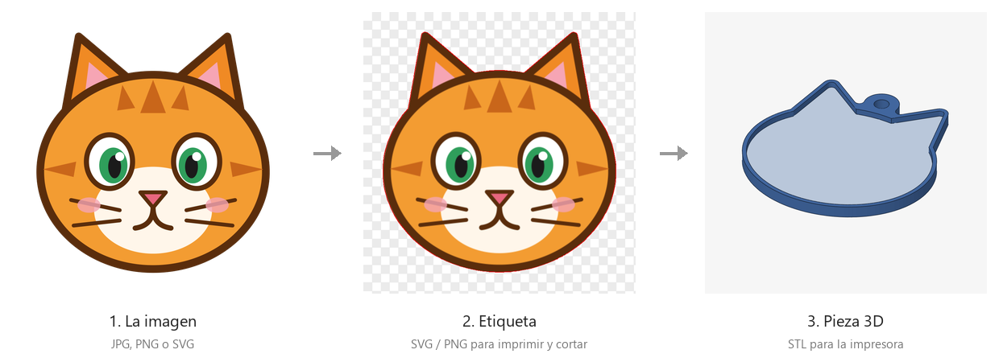
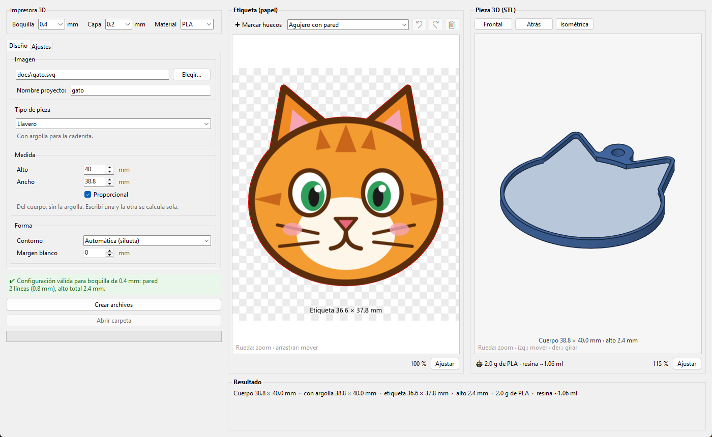

# Silueta3D

[](https://github.com/MatiasArielDB/Silueta3D/actions/workflows/pruebas.yml)

**De una imagen a una pieza lista para imprimir en 3D y encapsular en resina, en segundos.**

Silueta3D toma un escudo, un logo o un dibujo (JPG, PNG o SVG) y genera todo lo necesario para hacer
**llaveros, imanes, pines o bases** con una etiqueta de papel adentro, cubierta con resina o vidrio líquido.



## El problema

Una pieza de este tipo tiene dos partes que tienen que encajar perfecto:

1. una **etiqueta de papel**, impresa y cortada con plotter siguiendo la silueta del diseño;
2. una **base impresa en 3D**, con un hueco del tamaño exacto de la etiqueta, una pared alrededor y la argolla.

### Antes: a mano, en dos programas, para cada diseño

| # | Paso | Programa |
|---|---|---|
| 1 | Seleccionar todo el diseño y unificarlo (Buscatrazos → Unificar) para obtener la silueta | Illustrator |
| 2 | Dibujar los círculos de la argolla (externo 3,2 mm, interno 2 mm) | Illustrator |
| 3 | Exportar e importar en Fusion 360 | Illustrator → Fusion |
| 4 | Escalar ×1,3324 para corregir las unidades (y verificar) | Fusion |
| 5 | Calcular a mano el desfase: 0,8 mm de pared + ajuste de la etiqueta | — |
| 6 | Hacer el desfase de −1,13 mm (¡en negativo!) y borrar la silueta vieja | Fusion |
| 7 | Extruir a 2 mm | Fusion |
| 8 | Vaciar a 0,8 mm (dos capas de filamento) | Fusion |
| 9 | Armar la argolla (2 mm + 1,6 mm) | Fusion |
| 10 | Exportar el STL y nombrar a mano los archivos (`X_base3D`, `X_imprimir`, `X_original`, `X_stl`) | Fusion |
| 11 | Preparar aparte el archivo para imprimir y cortar la etiqueta | Illustrator / plotter |

Cada diseño nuevo implicaba repetir todo. Cualquier error (la escala, el signo del desfase, una
cuenta mal hecha) se descubría recién al imprimir, cuando la etiqueta no entraba en el hueco.

### Ahora: tres pasos

1. **Elegir la imagen.**
2. **Escribir la medida** (por ejemplo 40 mm de alto).
3. **Crear archivos.**

Silueta3D saca la silueta, calcula el hueco, la pared y la argolla, y guarda la etiqueta para el plotter
y el STL para la impresora **en 1 a 3 segundos**. La pieza se ve en 3D y se actualiza en vivo con cada cambio.

| | Antes | Con Silueta3D |
|---|---|---|
| Pasos por diseño | ~11, en dos programas | 3, en uno |
| Cuentas a mano (escala, desfase, capas) | sí | no: se calculan solas a partir de la boquilla |
| Etiqueta y hueco | se hacían por separado | salen del mismo contorno: siempre encajan |
| Ver el resultado | recién al imprimir | en vivo, en 3D, antes de imprimir |
| Archivos | nombrados a mano | carpeta por proyecto, con todo adentro |
| Peso y resina | — | calculados para cada pieza |

## Así se ve



A la izquierda se configura la impresora y la pieza; en el centro, la etiqueta que se imprime y se
corta (línea roja); a la derecha, la pieza 3D que se va a imprimir, que se puede girar, con su peso
y la resina que lleva. Todo se actualiza en vivo con cada cambio.

## Qué hace

- **Silueta automática:** saca el fondo (transparente o de color uniforme) y sigue el contorno del diseño.
  Si la imagen no tiene fondo claro (una foto), usa círculo, rectángulo redondeado o escudo.
- **Medidas pensadas para la impresora:** se elige la boquilla y la altura de capa; la pared se define en
  *líneas* y el piso en *capas*, así todo es imprimible justo. Un control marca en vivo si la
  configuración es válida (verde), riesgosa (naranja) o imposible (rojo).
- **Tipos de pieza:** Llavero (argolla), Imán (hueco atrás), Pin / Snap (cabeza escondida adentro y
  vástago por atrás) o Base sola.
- **Huecos calados** con un clic, como la varita mágica (por ejemplo el espacio entre el brazo y el cuerpo).
- **Peso estimado** de la pieza según el filamento y **resina** necesaria.
- **Etiqueta con sangrado** (la imagen se extiende 0,5 mm por fuera del corte) para que no quede borde blanco.

## Instalación

Hace falta **Python 3.10 o superior** con **tkinter** (la librería de ventanas). El instalador crea un
entorno aparte (`.venv`) e instala las dependencias de `requirements.txt`; no toca el resto del sistema.

### Windows

1. Instalar [Python](https://www.python.org/downloads/) marcando *Add python.exe to PATH*
   (el instalador oficial ya trae tkinter).
2. Doble clic en **`instalar.bat`** (solo la primera vez).
3. Doble clic en **`Silueta3D.bat`** para abrir el programa.

### Linux

1. Instalar Python con tkinter y venv:

   | Distribución | Comando |
   |---|---|
   | Ubuntu / Debian / Mint | `sudo apt install python3 python3-venv python3-tk` |
   | Fedora | `sudo dnf install python3 python3-tkinter` |
   | Arch / Manjaro | `sudo pacman -S python tk` |

2. En la carpeta del programa:

   ```bash
   ./instalar.sh      # solo la primera vez
   ./silueta3d.sh     # abre el programa
   ```

### macOS

1. Instalar Python desde [python.org](https://www.python.org/downloads/) (trae tkinter) o con Homebrew:
   `brew install python python-tk`.
2. En la Terminal, dentro de la carpeta del programa: `./instalar.sh` (solo la primera vez).
3. Para abrirlo: doble clic en **`Silueta3D.command`** (o `./silueta3d.sh` desde la Terminal).

> Usado y probado a mano en **Windows 11**. Además, en cada cambio GitHub Actions instala el programa
> desde cero y corre las pruebas en **Linux (Ubuntu)**, **Windows** y **macOS** (pestaña *Actions* del
> repositorio). Si encontrás algo raro en tu sistema, abrí un *issue*.

### Controles según el sistema

| Acción | Windows / Linux | macOS |
|---|---|---|
| Deshacer / rehacer huecos | Ctrl+Z / Ctrl+Y | Cmd+Z / Cmd+Y |
| Girar la pieza 3D | botón derecho | botón derecho (o dos dedos + clic) |
| Zoom | rueda del mouse | rueda o gesto de desplazamiento |

## Uso

1. Arriba, la **impresora**: boquilla, altura de capa (solo se ofrecen las válidas) y material.
2. Pestaña **Diseño**, en orden:
   - **Imagen**: *Elegir…* y el nombre del proyecto.
   - **Tipo de pieza**: Llavero, Imán, Pin / Snap o Base (sus opciones aparecen en la pestaña *Ajustes*).
   - **Medida** del cuerpo, sin la argolla. Con *Proporcional* marcado se escribe el alto o el ancho y el
     otro se completa solo; desmarcado se usan los dos y la imagen se estira.
   - **Forma**: contorno automático u otra forma, y margen blanco opcional.
   Para probar, en `docs/gato.svg` hay una imagen de ejemplo.
3. Revisar la vista: a la izquierda la etiqueta (línea roja = corte), a la derecha la pieza 3D con su peso.
   Lo que se ve es exactamente lo que se guarda.
4. **Crear archivos** genera `salida\<proyecto>\`:

| Archivo | Para qué |
|---|---|
| `<proyecto>_imprimir.svg` | imagen + línea de corte (capa *Corte*, roja) para el software del plotter |
| `<proyecto>_imprimir.png` | la imagen sola a 300 dpi, mismo tamaño que el SVG |
| `<proyecto>_corte.svg` | solo la línea de corte, mismo lienzo que el PNG |
| `<proyecto>_base3D.svg` | contornos de la base (para revisar o editar) |
| `<proyecto>_stl.stl` | pieza para la impresora 3D (mm) |
| `<proyecto>_parametros.txt` | medidas, peso, resina, valores usados e instrucciones |

## Cómo funciona

```
etiqueta = silueta del diseño (+ margen blanco opcional)        -> línea de corte del plotter
hueco    = etiqueta + holgura (0,3 mm por lado)                  -> donde entra el papel
exterior = hueco + pared (2 líneas = 0,8 mm)  (+ argolla)        -> contorno de la pieza
pieza    = piso 6 capas (1,2 mm) + hueco 6 capas (1,2 mm) = 2,4 mm de alto
peso     = volumen del STL × densidad del filamento (relleno 100 %)
```

Si el contorno tiene una entrada más angosta que dos paredes, el papel la cubre y la pared sigue el
contorno de afuera, para que no queden "bahías" de plástico macizo.

### Tipos de pieza

| Tipo | Qué agrega | Ajustes |
|---|---|---|
| **Llavero** | argolla para la cadenita | posición, pared (líneas), agujero |
| **Imán** | hueco redondo atrás para pegar un imán de neodimio; el piso se engrosa solo | diámetro, espesor, ajuste |
| **Pin / Snap** | rebaje adentro (tapado por la etiqueta) para la cabeza y agujero pasante para el vástago | cabeza, espesor, agujero, ajuste |
| **Base** | nada: la pieza sola | — |

### Huecos calados

Por defecto los huecos interiores del dibujo se rellenan (no se puede distinguir un hueco de una parte
blanca del dibujo). Para calar uno: activar **Marcar huecos** y hacer clic sobre él. Ctrl+Z deshace y
Ctrl+Y rehace.

- **Agujero con pared:** queda vacío, con su pared dentro del hueco (nunca tapa el dibujo). Si no entra,
  queda solo en el papel y el programa avisa desde qué tamaño de pieza entraría.
- **Ventana:** se perfora papel y piso; al echar la resina se pega cinta debajo y queda una ventana transparente.
- **Solo en el papel:** se ve el piso de la pieza.

### Vista previa

- **Etiqueta:** rueda = zoom, arrastrar = mover, *Ajustar* = verla entera.
- **Pieza 3D:** botón izquierdo = mover, botón derecho = girar, rueda = zoom; *Ajustar*, *Frontal*,
  *Atrás* e *Isométrica*. Azul = plástico, celeste = piso donde va la etiqueta, naranja = huecos de imán o pin.

## Consejos

- **Impresión 3D** (por ejemplo Ender 3 S1 con boquilla 0,4): capa 0,2 mm, ancho de línea = boquilla,
  2 paredes, piso hacia abajo, relleno 100 %, sin soportes.
- **Resina:** sellar el papel antes (cinta transparente, laminado en frío o sellador tipo Mod Podge);
  si no, se oscurece y la tinta puede correrse. Pegar la etiqueta al piso y nivelar la pieza antes de llenar.
- **Si algo no sale bien:**
  - queda fondo pegado al diseño → subir *Tolerancia de fondo*; se come partes claras → bajarla;
  - la etiqueta entra justa o floja → cambiar *Holgura etiqueta*;
  - contorno con muchos piquitos → subir *Suavizado* o poner *Margen blanco*.

## Por consola

Sin abrir la ventana (en Windows el intérprete es `.venv\Scripts\python.exe`; en Linux y macOS, `.venv/bin/python`):

```
.venv/bin/python programa/llavero_core.py imagen.png --alto 40 [--ancho 35] [--nombre x]
    [--margen 1] [--boquilla 0.4] [--lineas-pared 2]
    [--tipo-pieza Llavero|Imán|"Pin / Snap"|"Base (sin argolla ni imán)"] [--iman 10x2] [--pin 8x1x1.2]
```

## Pruebas

```
.venv/bin/python tests/probar.py          (Windows: .venv\Scripts\python.exe tests\probar.py)
.venv/bin/python tests/ventana.py         (en Linux sin pantalla: xvfb-run .venv/bin/python tests/ventana.py)
```

- `probar.py`: medidas, peso y que cada STL quede cerrado, para todos los tipos de pieza, huecos y formas.
- `ventana.py`: abre la ventana, carga una imagen, recorre los tipos de pieza y crea los archivos
  (usa carpetas temporales: no toca tus preferencias ni `salida`).

Las dos corren solas en cada cambio en Linux, Windows y macOS (`.github/workflows/pruebas.yml`).

## Estructura

```
Silueta3D.bat         abre el programa (Windows)
instalar.bat          crea el entorno e instala dependencias (Windows)
silueta3d.sh          abre el programa (Linux / macOS)
instalar.sh           crea el entorno e instala dependencias (Linux / macOS)
Silueta3D.command     doble clic para abrir en macOS
requirements.txt
programa/
  llavero_app.py      ventana (tkinter)
  llavero_core.py     imagen -> silueta -> geometría -> SVG / PNG / STL
  visor3d.py          visor 3D (sin OpenGL)
tests/
  probar.py           pruebas del núcleo
  ventana.py          prueba de la ventana
  imagenes/           imágenes de prueba
.github/workflows/    pruebas automáticas en Linux, Windows y macOS
docs/                 imágenes del README y gato.svg de ejemplo
salida/               lo que genera el programa (no se sube al repositorio)
```

## Licencia

[MIT](LICENSE): podés usarlo, modificarlo y compartirlo libremente, manteniendo el aviso de autoría.
